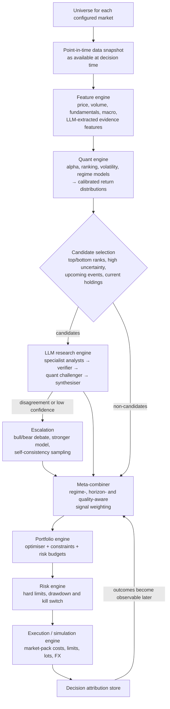
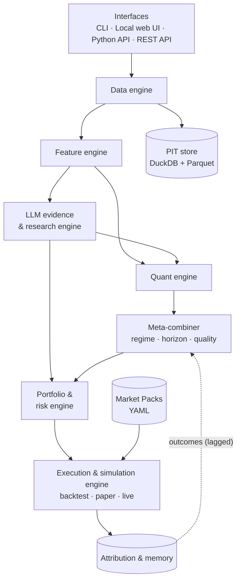
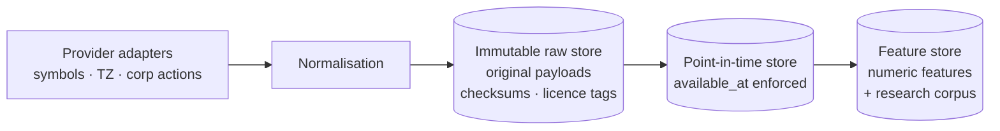

# LearnTrade

> **Read this first.** This document describes the **target design** of LearnTrade, not only what is built today.
> Several parts below (browser setup wizard, Settings pages, fundamentals data, broker connections, the full
> multi-agent research flow in daily use) are goals. **[STATUS.md](STATUS.md) lists exactly what is implemented and
> tested, what is experimental, and what is only planned.** Where they disagree, STATUS.md is right.


**A local-first, market-agnostic trading intelligence engine that puts quantitative models first and adds LLM research on top.**

LearnTrade forecasts, ranks and sizes positions for equities on **any exchange in any country**. A statistically trained quant core produces calibrated forecasts. Large language models extract evidence from filings and news and challenge the forecasts. A portfolio engine, not an LLM, decides the final weights.

It is built to be **cloned and running in minutes**, on a laptop without a GPU, with cloud or local LLMs as an option. Accuracy is not traded away for that simplicity.

**You don't need to be a programmer to use it.** Download the project, double-click **Start LearnTrade**, and a setup wizard opens in your browser. It asks where you invest, then sets everything else up for you. Developers get a full CLI, Python API and plugin system on the same local install.

> **Status:** pre-alpha / design stage. This README is the architecture specification and project plan. Features are described as designed; see [Roadmap](#roadmap) for what is built.

> **Disclaimer:** LearnTrade is research software. It is not financial advice, and it guarantees no returns. Live order execution is off by default and must be enabled explicitly. You are responsible for every trade you place and for complying with the data licences and regulations of your jurisdiction.

---

## Table of contents

- [Why LearnTrade](#why-learntrade)
- [Design principles](#design-principles)
- [Features](#features)
- [Getting started (no coding needed)](#getting-started-no-coding-needed)
- [The setup wizard](#the-setup-wizard)
- [Using LearnTrade day to day](#using-learntrade-day-to-day)
- [Quick start for developers](#quick-start-for-developers)
- [Updating, backups and uninstalling](#updating-backups-and-uninstalling)
- [Troubleshooting](#troubleshooting)
- [How a decision is made](#how-a-decision-is-made)
- [Architecture](#architecture)
  - [1. Core domain model](#1-core-domain-model)
  - [2. Market abstraction (Market Packs)](#2-market-abstraction-market-packs)
  - [3. Data engine](#3-data-engine)
  - [4. Feature engine](#4-feature-engine)
  - [5. Quant engine](#5-quant-engine)
  - [6. LLM evidence and research engine](#6-llm-evidence-and-research-engine)
  - [7. Meta-combiner](#7-meta-combiner)
  - [8. Portfolio and risk engine](#8-portfolio-and-risk-engine)
  - [9. Execution and simulation engine](#9-execution-and-simulation-engine)
  - [10. Attribution and memory](#10-attribution-and-memory)
  - [11. Interfaces](#11-interfaces)
- [Configuration](#configuration)
- [Using LearnTrade in your country](#using-learntrade-in-your-country)
- [Extending LearnTrade](#extending-learntrade)
- [LLM providers, cost and accuracy controls](#llm-providers-cost-and-accuracy-controls)
- [Evaluation methodology](#evaluation-methodology)
- [Project structure](#project-structure)
- [Tech stack](#tech-stack)
- [Roadmap](#roadmap)
- [Contributing](#contributing)
- [Glossary](#glossary)
- [Acknowledgements](#acknowledgements)
- [License](#license)

---

## Why LearnTrade

Most LLM trading-agent systems let a chain of LLM "analysts", "traders" and "managers" produce the final BUY/SELL label. That design has structural limits:

- **Nothing learns from data.** No component is fitted to historical outcomes; "learning" amounts to prose reflections.
- **The output is a label, not a forecast.** A label carries no calibrated probability, no expected return, no risk estimate, and gives no principled basis for sizing.
- **One ticker at a time.** Ranking stocks against each other is more predictable than calling direction in isolation, and these systems don't do it.
- **The model already knows the answer.** An LLM backtested on dates before its training cutoff has memorised what happened next. Point-in-time data controls do not remove that leak.
- **Cost grows with tickers × dates × agents × debate rounds.** Every rerun pays again.

LearnTrade inverts the design:

| Concern | LearnTrade's approach |
|---|---|
| Forecasting | Trained, calibrated quant ensembles predicting return **distributions** for each horizon |
| Use of LLMs | (a) Per-document **evidence extraction** turned into model features. (b) Selective **research and challenge** on candidates |
| Combining signals | A **meta-combiner** that learns, from data, how much to trust each signal by regime, horizon and data quality |
| Allocation | A **portfolio optimiser** with explicit constraints. LLMs explain allocations; they never set weights |
| Realism | A shared **event-driven simulator** with per-market costs, limits, lots, calendars and currency |
| Honesty | **Point-in-time** data, LLM **training-cutoff contamination guards**, purged walk-forward validation, ablation gates |
| Footprint | `uv sync`, DuckDB + Parquet, a single Python process; GPU and cloud optional |

---

## Design principles

1. **Accuracy first, cost second.** Cost only decides between options of equal measured accuracy. Never optimise for the cheapest model; optimise for the best decision quality per unit of total cost.
2. **Market-agnostic core.** Nothing in the core knows about a specific country, exchange, currency, tax or broker. All of that lives in **Market Packs** and **plugins**.
3. **Quant models forecast. LLMs research and challenge. The optimiser allocates. The risk engine enforces.**
4. **No feature ships without evidence.** Every component, whether an agent, model, debate step or memory, must show incremental out-of-sample value in an ablation before it is enabled by default.
5. **Point-in-time everything.** Every observation records when it became *available*, not just when it *happened*.
6. **Forecast distributions, not labels.** Expected return, P(positive), volatility and quantiles.
7. **One simulator.** Backtesting, paper trading and live trading share the same execution and cost logic.
8. **Reproducible by default.** Versioned data snapshots, configs, model artefacts and cached LLM responses.
9. **Local-first and private.** No mandatory hosted service. Credentials and account data stay on your machine, stored apart from research data.
10. **Lightweight install, heavyweight rigour.** Small dependency core; heavier options (deep learning forecasters, GPU serving, desktop shell) are optional extras.
11. **Usable without coding.** Every task a normal investor needs can be done by clicking in the local app, with no terminal and no config files to edit. The CLI and config files remain for those who want them, and both paths run the same engine.
12. **Safe by default for beginners.** Paper trading is on by default, live trading is hidden in Simple mode, and every forecast is shown with its uncertainty and its risks in plain language.

---

## Features

**Easy to use**
- Double-click launchers for Windows, macOS and Linux; no need to install Python or Node first
- Works from **Download ZIP** as well as `git clone`; no Git knowledge required
- A browser-based setup wizard: pick your country, and exchanges, currency, holidays, costs and free data sources are filled in for you
- **Simple mode** (plain-language ideas, portfolio health check, explanations) and **Advanced mode** (strategy lab, backtests, model and agent settings)
- Ready-made **investor profiles** (long-term, swing, active) and **risk levels** (conservative, balanced, aggressive)
- **Demo mode** with bundled sample data, so you can explore before downloading anything
- Holdings import from your broker's CSV/Excel file, with automatic column detection
- "What does this mean?" help on every number, plus a built-in glossary
- One-click updates, backups and a **Fix problems** button that diagnoses common issues
- Interface languages and local number/currency/date formats

**Markets and data**
- Works with any exchange, identified by its ISO 10383 MIC code (`XNYS`, `XNSE`, `XLON`, `XTKS`, `XETR`, `XASX`, …)
- Market Packs: declarative YAML for calendars, sessions, currency, lot/tick size, price limits, settlement, short-selling rules and cost/tax models
- Pluggable data providers, each labelled with how point-in-time-safe it is
- Point-in-time store with immutable raw snapshots and full provenance
- Corporate-action handling, survivorship-aware universes, data-quality checks

**Forecasting**
- Separate models and targets for intraday, swing and positional horizons
- Cross-sectional ranking and absolute-return models
- Volatility and regime models
- Probability calibration, quantile forecasts and conformal prediction intervals

**LLM layer (optional, pluggable)**
- Evidence extraction from filings, transcripts and news: each document is processed once, cached and turned into model features
- Specialist research roles: technical, fundamental, macro, event, bull, bear, evidence verifier, quant challenger, synthesiser
- Uncertainty- and disagreement-driven escalation, with debate only when it is warranted
- Any provider: OpenAI-compatible APIs, Anthropic, Google, local models via Ollama / llama.cpp / vLLM
- Contamination guard based on each model's training cutoff

**Portfolio and execution**
- Equal-weight, inverse-volatility, mean-variance, HRP, risk parity and CVaR allocators
- Constraints on position, sector, country, currency, liquidity and turnover
- Multi-currency portfolios with a configurable base currency
- Event-driven simulator: next-bar fills, spreads, impact, fees, taxes, partial fills, halts, price limits
- Holdings import from CSV/XLSX; read-only broker adapters; optional execution behind a kill switch

**Transparency**
- A Decision Attribution record for every decision: which models, agents, evidence and costs went into it, and what happened afterwards
- Reproducible research reports and ablation results

---

## Getting started (no coding needed)

You need a computer running Windows 10+, macOS 12+ or a recent Linux, about 2 GB of free disk space, and an internet connection for the first setup. **You do not need to install Python, Node or anything else yourself.**

### Step 1: Get LearnTrade

Choose **one** option:

- **Download ZIP (easiest):** on the GitHub page, click the green **Code** button → **Download ZIP**, then unzip it anywhere (for example, your Documents folder).
- **Or clone with Git**, if you already use it:

  ```bash
  git clone https://github.com/<your-org>/learntrade.git
  ```

Both give you exactly the same app.

### Step 2: Start it

Open the `learntrade` folder and double-click the launcher for your system:

| System | Double-click | If your system blocks it |
|---|---|---|
| **Windows** | `Start LearnTrade.bat` | If SmartScreen appears, click **More info → Run anyway** |
| **macOS** | `Start LearnTrade.command` | Right-click → **Open** → **Open** (only needed the first time) |
| **Linux** | `start.sh` (or run `./start.sh` in a terminal) | Make it executable: right-click → Properties → Allow executing |

**The first start takes a few minutes.** A window shows progress while the launcher:
1. Installs [uv](https://docs.astral.sh/uv/), a small, self-contained Python manager, inside your user folder. It needs no admin rights and changes no system settings.
2. Downloads the correct Python version for LearnTrade, kept separate from any Python you already have.
3. Installs LearnTrade's locked, tested dependencies.
4. Starts LearnTrade and **opens it in your web browser** at `http://localhost:8787`.

Later starts take a few seconds. LearnTrade runs **only on your computer**; the browser is just its window, and nothing is hosted online.

To stop LearnTrade, close the launcher window (or click **Quit** in the app's menu).

### Step 3: Follow the setup wizard

The first time you open it, LearnTrade walks you through setup. See the next section.

### Prefer Docker?

If you already use Docker, this does the same thing without the launcher:

```bash
docker compose up
```

Then open `http://localhost:8787`. Your data is kept in the `./data` folder.

---

## The setup wizard

Every step is plain language and can be changed later in **Settings**. Nothing is ever sent to LearnTrade's developers.

| Step | What you're asked | What LearnTrade does for you |
|---|---|---|
| **1. Welcome** | Read and accept the risk notice | Turns on paper trading (practice mode with no real money) |
| **2. Where do you invest?** | Pick your country (or several) | Selects the matching exchanges, currencies, trading hours, holidays, fees and taxes from the Market Packs |
| **3. Your currency** | Confirm your home currency | Reports everything in it and converts foreign holdings automatically |
| **4. Data sources** | Keep the free sources (recommended), or add a paid provider | Picks the best free sources for your country. A **Get a key** link and a **Test** button come with any paid option |
| **5. AI assistant** | **None** / **Free, on this computer** / **Cloud** | *None:* uses only the statistical models. *On this computer:* checks your RAM and disk, recommends a model that fits, and downloads it with a progress bar. *Cloud:* paste a key (with a link showing where to get one) and set a **monthly spending limit** |
| **6. Your investing style** | Choose a profile and a risk level | Sets horizons, position sizes and limits (see the presets below) |
| **7. Your portfolio** | Upload your broker's holdings file, type holdings in, start with a watchlist, or try the demo portfolio | Detects columns automatically and shows a preview before importing |
| **8. First download** | Click **Start** | Downloads history and trains the first models in the background, with a time estimate. You can explore **Demo mode** while it runs |

### Investor profiles and risk levels

| Profile | Looks ahead | Suited to |
|---|---|---|
| **Long-term investor** | 2–6 months | Reviewing a portfolio monthly; fundamentals matter most |
| **Swing trader** | 1–4 weeks | Checking ideas a few times a week |
| **Active trader** | Hours to days | Daily attention; higher costs and risk (Advanced mode only) |

| Risk level | Largest single holding | Largest sector | Drawdown alert |
|---|---|---|---|
| **Conservative** | 4% | 20% | 10% |
| **Balanced** | 6% | 25% | 15% |
| **Aggressive** | 10% | 35% | 25% |

Presets are plain files in `presets/`, so the community can add and improve them. Picking a preset only fills in settings; you can fine-tune each one in Advanced mode.

### Hardware guide for the free on-computer AI

LearnTrade works well **without** AI. If you add it, the wizard recommends a model based on your machine:

| Your computer | Recommended local AI | Notes |
|---|---|---|
| Under 8 GB RAM | None, or Cloud | The statistical models still work fully |
| 8–16 GB RAM | Small model (≈3–8B parameters) | Good for reading news and filings |
| 16–32 GB RAM or Apple Silicon | Medium model (≈14B) | Good research quality |
| Dedicated GPU, 12 GB+ | Larger models | Fastest; optional |

Local AI runs through [Ollama](https://ollama.com). The wizard offers to install it and explains each step.

---

## Using LearnTrade day to day

### Simple mode (default)

| Screen | What you see |
|---|---|
| **Home** | Today's top ideas as cards. Each says, for example: *"58% chance of beating the market over the next 4 weeks"*, with a confidence meter, the main reasons, the main risks and *"What would change this view"* |
| **My portfolio** | Value in your currency, gains and losses, and a **Health check** that flags things like too much in one stock, sector or currency |
| **Suggested changes** | Proposed buys and sells with estimated fees and taxes, and a plain explanation of why. Nothing is ever traded automatically |
| **Watchlist** | Stocks you follow, with alerts when the view on them changes |
| **Research** | A readable report on any stock: what's happening, the bull case, the bear case, and the evidence with links to the source documents |
| **Practice trading** | A paper portfolio that follows suggestions so you can see how they perform over time without real money |
| **Learn** | The glossary and short explanations of how LearnTrade works and its limits |

Every number has a **ⓘ What does this mean?** button. Probabilities are always shown with a reminder that they are estimates, not certainties.

### Advanced mode

Switch in **Settings → Mode**. This adds:
- **Strategy lab:** change horizons, models, features, allocators and constraints
- **Backtests:** run historical simulations with full cost reports
- **AI settings:** which roles run, models per task, escalation rules, budgets
- **Model reports:** forecast accuracy, calibration and ablation results
- **Decision history:** the full attribution record for every decision
- **Broker connections** and, if you explicitly enable it, live trading with confirmations, limits and a kill switch

### Data refresh

LearnTrade refreshes data and forecasts automatically **when it's running**: on start, and on a schedule you choose (default: once a day after your market closes). There's also a **Refresh now** button.

---

## Quick start for developers

The launchers above run the same commands shown here. Use this path if you are comfortable with a terminal.

### Requirements

- [uv](https://docs.astral.sh/uv/), which installs the right Python automatically (Python 3.11+ if you use pip instead)
- Optional: Node 20+ (only to change the UI; a prebuilt UI ships in the repository), an LLM API key or a local model runtime such as [Ollama](https://ollama.com)

### Install

```bash
git clone https://github.com/<your-org>/learntrade.git
```

```bash
cd learntrade && uv sync
```

Optional extras:

```bash
uv sync --extra llm        # LLM providers and document processing
```

```bash
uv sync --extra deep       # deep-learning forecasters (PatchTST, TSMixer, …)
```

```bash
uv sync --extra ui         # local web UI server
```

```bash
uv sync --all-extras       # everything
```

### Initialise a workspace

```bash
uv run learntrade init
```

This is the terminal version of the setup wizard (or run `uv run learntrade serve --open` to use the browser wizard). It asks for:
- **Markets** you trade (any MIC; packs that ship with LearnTrade are listed, and any other exchange can use the `generic` pack)
- **Base currency** for portfolio reporting
- **Data providers** and their API keys (written to `.env`, never to the config file)
- **LLM providers** (or none)

It writes `config/learntrade.toml` and `.env` (API keys go to your OS keychain when available).

### Typical workflow

```bash
uv run learntrade data pull --since 2012-01-01            # prices, fundamentals, macro, news
```

```bash
uv run learntrade data check                              # leakage, gaps, duplicates, corporate actions
```

```bash
uv run learntrade train --horizon swing                   # walk-forward training + calibration
```

```bash
uv run learntrade backtest --strategy default --from 2018-01-01
```

```bash
uv run learntrade rank --market XNSE --top 20             # today's ranked opportunities
```

```bash
uv run learntrade analyze XNYS:AAPL                       # full research report for one instrument
```

```bash
uv run learntrade portfolio import holdings.csv           # bring in your current holdings
```

```bash
uv run learntrade rebalance --dry-run                     # proposed trades with costs and attribution
```

```bash
uv run learntrade serve                                   # local UI at http://localhost:8787
```

Running with no LLM configured is fully supported: the quant, portfolio and execution engines work on their own.

---

## Updating, backups and uninstalling

**Updating**
- In the app: **Settings → Check for updates → Update**. LearnTrade backs up your settings and data first, updates itself, and restarts.
- From a terminal: `uv run learntrade update` (runs `git pull` for clones, or downloads the latest release for ZIP installs, then reinstalls dependencies).

Your data, settings and portfolios live in the `data/` and `config/` folders and are never touched by updates.

**Backups**
- **Settings → Backup** creates a single `.zip` with your settings, portfolios, watchlists and decision history. **Restore** loads one.
- API keys are stored in your system's secure keychain and are **not** included in backups unless you choose to include them (encrypted with a password).

**Moving to a new computer:** install LearnTrade there, then restore your backup in the wizard's first step.

**Uninstalling:** delete the `learntrade` folder. To also remove the Python manager, delete uv's folder (shown in **Settings → About**). LearnTrade installs nothing else on your system, apart from Ollama if you chose to install it; Ollama has its own uninstaller.

---

## Troubleshooting

Start with **Settings → Fix problems** (or `uv run learntrade doctor` in a terminal). It checks your installation, internet access, data sources, API keys, disk space and AI setup, explains each problem in plain language, and offers a **Fix** button where it can.

| Problem | What to do |
|---|---|
| The launcher window closes immediately | Open a terminal in the folder and run `./start.sh` (macOS/Linux) or `"Start LearnTrade.bat"` (Windows) to see the message, or check `logs/launcher.log` |
| The browser doesn't open | Go to `http://localhost:8787` yourself |
| "Port already in use" | LearnTrade is probably already running. Otherwise, change the port in **Settings → Advanced** or run `uv run learntrade serve --port 8790` |
| A data source fails | **Fix problems** tests each source; free sources sometimes rate-limit, and LearnTrade retries and falls back to the next source automatically |
| The AI is slow on my computer | Choose a smaller model in **Settings → AI**, or switch to Cloud, or None |
| A cloud AI spending limit was reached | The statistical models keep working; AI research resumes when the limit resets or you raise it |
| I want help from the community | **Settings → Fix problems → Create support bundle** makes a zip of logs with your keys and portfolio removed. Attach it to a GitHub issue |

---

## How a decision is made



Each decision produces a structured, auditable record:

```json
{
  "decision_id": "2026-11-12T10:00:00Z/XNSE:INFY/swing",
  "instrument": "XNSE:INFY",
  "horizon": "swing_20d",
  "as_of": "2026-11-12T10:00:00+05:30",
  "forecast": {
    "expected_excess_return": 0.018,
    "p_positive": 0.58,
    "volatility": 0.061,
    "quantiles": {"q05": -0.081, "q50": 0.015, "q95": 0.112},
    "cross_sectional_rank": 0.91
  },
  "research": {
    "thesis": "…",
    "counter_thesis": "…",
    "invalidation_conditions": ["…"],
    "evidence": [{"source_id": "…", "available_at": "…", "claim": "…", "verified": true}],
    "agreement_with_quant": "agree"
  },
  "portfolio": {"target_weight": 0.032, "current_weight": 0.0, "trade": "BUY", "est_cost_bps": 21.4},
  "attribution": {"models": {"lgbm_rank_v3": 0.46, "vol_garch": 0.12, "llm_event_features": 0.19}, "llm_cost_usd": 0.004},
  "data_quality": {"pit_level": "full", "stale_fields": []}
}
```

---

## Architecture

LearnTrade is a set of engines with typed contracts between them. None of them is "an agent" by default; LLM agents are one engine among several.



### 1. Core domain model

Every module speaks the same Pydantic types. The important ones:

```python
class InstrumentId(str):
    """'<MIC>:<SYMBOL>' e.g. 'XNYS:IBM', 'XNSE:RELIANCE', 'XTKS:7203', 'XLON:VOD'.
    Optionally linked to ISIN / FIGI for cross-listing and symbol-change resolution."""

class Instrument(BaseModel):
    id: InstrumentId
    mic: str                      # ISO 10383 exchange code
    symbol: str
    isin: str | None
    figi: str | None
    currency: str                 # ISO 4217
    asset_class: Literal["equity", "etf", "index", "fx", "future", "crypto"]
    listed_from: date | None
    delisted_on: date | None      # required for survivorship-free universes
    sector: str | None            # taxonomy is configurable (GICS-like, ICB, custom)

class Observation(BaseModel):
    instrument_id: InstrumentId | None   # None for macro / market-wide data
    source_id: str
    kind: str                     # "bar", "fundamental", "filing", "news", "macro", …
    event_time: datetime          # when it happened / period it refers to
    available_at: datetime        # when it became publicly knowable (UTC)
    ingested_at: datetime
    payload: dict
    source_version: str
    pit_level: Literal["full", "partial", "none"]

class Forecast(BaseModel):
    instrument_id: InstrumentId
    as_of: datetime
    horizon: str                  # "intraday_1h", "swing_5d", "positional_60d", …
    expected_return: float        # excess over the market's configured benchmark
    p_positive: float             # calibrated
    volatility: float
    quantiles: dict[str, float]
    rank: float | None            # cross-sectional percentile within universe
    model_id: str
    data_snapshot_id: str
```

**Golden rule:** any query made "as of time *t*" only sees observations with `available_at <= t`. The store enforces this; individual models are not trusted to do it.

All timestamps are stored in UTC. Each market's local time zone and sessions come from its Market Pack.

### 2. Market abstraction (Market Packs)

A **Market Pack** is a declarative file describing everything specific to an exchange. The core engine never hard-codes market rules.

`markets/XNSE.yaml`. Numbers are **illustrative**; always check current rates with your exchange or broker:

```yaml
mic: XNSE
name: National Stock Exchange of India
country: IN
currency: INR
timezone: Asia/Kolkata
calendar: exchange_calendars:XBOM     # or a custom holiday file
sessions:
  regular: { open: "09:15", close: "15:30" }
settlement: T+1
benchmark: "XNSE:NIFTY50"              # used for excess returns
lot_size: 1
tick_size:
  - { below: .inf, tick: 0.05 }
price_limits:                           # circuit / limit-up-limit-down rules
  type: percent_band
  bands_source: provider                # per-instrument bands from data provider
short_selling: { intraday: true, overnight: false }
costs:
  commission: { type: flat_or_bps, flat: 20.0, bps: 3.0, take: min }   # broker-specific: override in config
  taxes:
    - { name: transaction_tax, side: both, bps: 10.0, applies_to: delivery }
    - { name: stamp_duty, side: buy, bps: 1.5 }
  exchange_fees: { bps: 0.3 }
  regulatory_fees: { bps: 0.01 }
  vat_on_fees: { percent: 18.0, applies_to: [commission, exchange_fees] }
  spread_model: from_quotes_or_volatility
  impact_model: { type: square_root, coefficient: 0.1 }
fx:
  quote_currency: INR
data_defaults:
  prices: [nse_bhavcopy, yahoo]
  filings: [nse_disclosures]
```

Market Pack features:

| Field | Purpose |
|---|---|
| `calendar`, `sessions`, `timezone` | Trading days, half-days, auctions, holidays (uses [`exchange_calendars`](https://github.com/gerrymanoim/exchange_calendars) where available) |
| `currency`, `fx` | Multi-currency P&L and conversion into the user's base currency |
| `settlement` | Cash availability modelling (T+0 / T+1 / T+2) |
| `lot_size`, `tick_size` | Order rounding (e.g. board lots in some Asian markets) |
| `price_limits` | Daily limit bands / circuit breakers; the simulator refuses fills beyond them |
| `short_selling` | Whether shorts are allowed, and borrow costs |
| `costs` | Composable cost components: commission, side-specific taxes, exchange/regulatory fees, VAT/GST on fees, spread and impact models |
| `benchmark` | Benchmark for excess-return targets and alpha reporting |
| `data_defaults` | Preferred provider order for this market |

**Shipped packs** are community-maintained (see [Using LearnTrade in your country](#using-learntrade-in-your-country)). **Any exchange without a pack** can use `generic`, which takes its calendar from `exchange_calendars` and starts with conservative default costs you should override.

Your **broker's** actual commission schedule always overrides the pack's defaults in `config/learntrade.toml` (or **Settings → Markets → My broker fees**).

### 3. Data engine



**Provider adapters** implement a small protocol and declare what they support:

```python
class DataProvider(Protocol):
    id: str
    capabilities: set[Literal["bars_daily", "bars_intraday", "fundamentals",
                              "filings", "news", "macro", "corporate_actions",
                              "universe_history", "quotes"]]
    markets: set[str] | Literal["*"]          # MICs supported
    pit_level: dict[str, Literal["full", "partial", "none"]]
    licence: str                               # usage / redistribution notes

    def fetch(self, request: FetchRequest) -> Iterable[Observation]: ...
```

**Point-in-time levels**, shown on every decision and backtest report:

| Level | Meaning | Example |
|---|---|---|
| `full` | True availability timestamps, including restatements as vintages | Regulatory filings with acceptance timestamps; macro vintage archives |
| `partial` | Availability inferred with conservative lags | Fundamentals with no filing date, given an assumed reporting delay |
| `none` | Current-state data only; unsafe for historical evaluation | "Latest" fundamentals snapshots from free endpoints |

Backtests warn when they depend on `none`-level data and refuse to produce a "validated" report from it.

**Provider categories** (planned adapters; contributions welcome):

| Category | Global / multi-market | Country-specific examples |
|---|---|---|
| Prices (EOD / intraday) | Yahoo Finance (research use), Stooq, Tiingo, Polygon, EODHD, Alpha Vantage, Twelve Data, broker market-data APIs | NSE/BSE bhavcopy (IN), exchange-published end-of-day files |
| Filings / fundamentals | Financial Modeling Prep, EODHD | SEC EDGAR (US), NSE/BSE disclosures (IN), Companies House (UK), EDINET (JP), DART (KR), SEDAR+ (CA) |
| Macro | DBnomics, World Bank, IMF, OECD, BIS | FRED / ALFRED (US), ECB Data Portal (EU), RBI DBIE (IN), central-bank and statistics-office APIs |
| News / events | GDELT, RSS feeds, licensed news APIs | Exchange announcement feeds |
| Universes / constituents | Provider index membership history | Exchange-published constituent files |
| Holdings | CSV / XLSX import (any broker) | Broker adapters (plugins) |

> Having API access to data does not by itself give you the right to redistribute it. LearnTrade stores data only locally and never redistributes it. Check each provider's terms.

**Storage**

| Store | Technology | Contents |
|---|---|---|
| Raw store | Parquet files (partitioned by source/date) | Original payloads with checksums; append-only |
| PIT analytical store | DuckDB over Parquet | Bars, fundamentals, macro, features, forecasts |
| Research corpus | Parquet + local full-text index (DuckDB FTS); optional embeddings | Filings, transcripts, news, extracted evidence |
| App state | DuckDB (or SQLite) | Watchlists, portfolios, runs, attribution |
| Secrets | OS keychain (fallback: `.env`) | API keys, broker tokens, held apart from research data |

**Data quality checks** (`learntrade data check`), run automatically before training:
- Future leakage (`available_at > as_of` in any training row)
- Missing bars against the market calendar; duplicate observations
- Time-zone and session-boundary errors
- Corporate-action consistency (split/dividend adjustments vs. raw prices)
- Symbol changes, mergers and delistings mapped correctly
- Survivorship: the universe at date *t* includes instruments later delisted
- Outliers and stale prices

### 4. Feature engine

Features are declared once and computed point-in-time for any market:

- **Price/volume:** returns over several windows, momentum, reversal, volatility, range, volume surprises, liquidity (turnover, Amihud), gap behaviour, intraday profile for intraday horizons
- **Cross-sectional:** ranks and z-scores within market, sector and country; market- and sector-relative returns
- **Fundamental:** quality, value, growth, profitability, leverage, accruals, earnings surprise, revisions; each used only after its `available_at`
- **Macro and regime:** rates, curve slope, FX, market volatility, breadth, trend state, normalised per market
- **Event:** days to/since earnings, dividends, index changes, corporate actions
- **LLM evidence features:** structured outputs from the extraction stage (see §6), e.g. `guidance_change`, `event_type`, `management_tone`, `risk_flags`, `surprise_direction`, each with confidence and source provenance

Feature definitions are versioned; every model records the exact feature-set version it was trained on.

### 5. Quant engine

Each **horizon** is a separate prediction task with its own target, validation scheme, costs and decision rules:

| Horizon | Typical targets | Main inputs |
|---|---|---|
| Intraday | 15m / 1h forward excess returns | Intraday bars, liquidity, spreads, session effects |
| Swing | 5d / 20d forward excess returns | Daily features, events, momentum, LLM evidence |
| Positional | 60d / 120d forward excess returns | Fundamentals, macro, sector and factor exposures |

**Model families.** These are candidates that compete; only ones that pass the ablation gates become defaults:

| Task | Baselines | Advanced candidates |
|---|---|---|
| Return / excess-return | Ridge, logistic regression | LightGBM, CatBoost, XGBoost |
| Cross-sectional ranking | Factor composites | LightGBM LambdaRank / LambdaMART |
| Time-series forecasting | AR, EWMA | PatchTST, TSMixer, pretrained forecasting models (`deep` extra) |
| Volatility | EWMA, GARCH(1,1) | EGARCH, HAR realised-volatility models |
| Regime | Trend/volatility rules | HMM, change-point detection |
| Calibration | Platt scaling | Isotonic regression, conformal prediction |

**Outputs are distributions.** For each instrument and horizon the engine emits expected excess return, calibrated P(positive), forecast volatility and quantiles (q05/q50/q95) via quantile models or conformal intervals.

**Global vs. per-market models.** You can train one pooled model across all configured markets (market identity and market-normalised features as inputs) or separate per-market models. The pooled option helps small markets with little history; the choice is itself validated by ablation.

### 6. LLM evidence and research engine

The LLM layer is **optional**. It has two separate jobs.

#### 6a. Evidence extraction: one pass per document, cached for good

Every filing, transcript, announcement or news item is processed **once** into structured, schema-validated evidence:

```json
{
  "doc_id": "sha256:…",
  "instrument_ids": ["XETR:SAP"],
  "available_at": "2026-10-21T05:00:00Z",
  "event_type": "earnings",
  "guidance_change": "raised",
  "surprise_direction": "positive",
  "key_figures": [{"name": "revenue_growth_yoy", "value": 0.11, "unit": "ratio", "quote_span": [1203, 1288]}],
  "risk_flags": ["fx_headwind"],
  "confidence": 0.82,
  "extractor": {"model": "…", "prompt_version": "extract_v4"}
}
```

- Results are keyed by `(doc hash, extractor model, prompt version)`, so backtest reruns cost nothing.
- Numbers must cite a source span, and a deterministic check verifies them against the source text.
- These fields become **ordinary model features**. The quant engine learns statistically whether, and how much, they help.
- Multilingual documents are supported where the chosen model supports the language; the extraction schema stays language-neutral.

#### 6b. Research and challenge, on candidates

Logical roles, which can share one model or run as separate calls:

| Role | Responsibility |
|---|---|
| Technical analyst | Price structure, trend, momentum, liquidity context |
| Fundamental analyst | Statements, quality, valuation versus peers in the same market |
| Macro analyst | Rates, currency, policy, sector cycle for the instrument's country |
| Event analyst | Filings, earnings, announcements, news |
| Bull researcher | Strongest evidence-backed long thesis |
| Bear researcher | Strongest evidence-backed counter-thesis |
| Evidence verifier | Checks every numeric claim, citation, timestamp (`available_at ≤ as_of`) and contradiction |
| Quant challenger | Tests the narrative against the quant forecasts and historical base rates |
| Synthesiser | Structured thesis, uncertainty, invalidation conditions, agreement with quant |

**Orchestration** is a small typed state machine in plain Python, without LangChain or LangGraph:

1. **Fact sheet.** Deterministic Python builds a compact, verified fact sheet: indicators, ratios, deltas, recent evidence. LLMs never do arithmetic.
2. **Independent analysis.** Selected analysts run in parallel on the fact sheet and their own evidence.
3. **Verification.** The verifier removes unsupported claims.
4. **Escalation, only when warranted.** Bull/bear debate, a stronger model, or self-consistency sampling (N samples, agreement used as confidence) is triggered by:
   - disagreement between the LLM view and the quant forecast,
   - high forecast uncertainty or low calibration confidence,
   - material events (earnings, guidance changes, corporate actions),
   - large proposed position changes.
5. **Synthesis.** Structured output, validated against a schema.

Which roles run, and when escalation fires, is configuration chosen by measured accuracy. Running the full pipeline on every candidate is a valid configuration if it proves more accurate for your markets.

#### 6c. Contamination guard

LLMs memorise history. A model asked about a past date may "know" what happened next.

- Every model in the registry records its **training cutoff**.
- In backtests, LLM-derived signals for dates before `cutoff + safety_margin` are **flagged and excluded from validated metrics** by default.
- **Masking mode** anonymises names, tickers and dates, and rescales prices, to test whether LLM value comes from reasoning or from memory.
- Forward paper-trading is the gold standard for evaluating LLM components.

### 7. Meta-combiner

This component learns **how much to trust each signal in each context**:

```
w_i = f(signal_i, regime, horizon, market, data_quality, event_state)
```

Approaches, introduced in order, each kept only if it beats the one before:

1. Static weights (baseline)
2. Rolling out-of-sample IC / Sharpe weighting
3. Regime-conditioned weighting
4. Stacked meta-model trained on out-of-fold predictions
5. Contextual bandits for routing (which agents or models to invoke)

The combiner only ever trains on information available at each historical decision time. Outcomes enter its training data only after they become observable.

### 8. Portfolio and risk engine

**Inputs:** forecast distributions, current holdings, cash, base currency, constraints and risk budgets.

**Allocators** (configurable, each benchmarked):
- Equal weight and inverse volatility (baselines)
- Mean-variance with shrinkage covariance
- Hierarchical Risk Parity (HRP)
- Risk parity / risk budgeting
- CVaR optimisation

**Constraints:** maximum position, sector, country, currency and single-market exposure; liquidity (percentage of average daily volume); turnover; minimum trade size; lot rounding; long-only or long-short per market rules.

**Horizon sleeves:** intraday, swing and positional strategies get separate risk budgets inside one portfolio.

**Risk engine (hard limits, enforced after optimisation):**
- Maximum drawdown and daily-loss stops
- Exposure and leverage caps
- Concentration and correlation checks
- **Kill switch** that stops all order generation immediately

LLMs can *explain* an allocation; they never *set* weights.

### 9. Execution and simulation engine

One event-driven engine powers **backtest, paper trading and live trading**:

- Next-bar (or next-session) fills, never same-bar look-ahead
- Spreads from quotes when available, otherwise volatility-based estimates
- Market impact (square-root model) and participation limits
- Every cost component from the Market Pack, plus broker overrides
- Partial fills, halts, price-limit days with no fills, holidays, half-days
- Lot and tick rounding, settlement cycles and cash availability
- Corporate actions (splits, dividends, mergers, delistings)
- Currency conversion into the base currency

A fast **vectorised mode** for early research shares the same cost functions. Final reported results always come from the event-driven mode.

**Brokers**

```python
class BrokerAdapter(Protocol):
    id: str
    markets: set[str]
    capabilities: set[Literal["holdings", "positions", "orders_read",
                              "quotes", "place_order", "cancel_order"]]
    def holdings(self) -> list[Holding]: ...
    def place_order(self, order: Order) -> OrderAck: ...   # only if capability present
```

- **CSV/XLSX import works with any broker in any country**, with a column-mapping wizard.
- Read-only adapters are plugins; each declares its own capabilities.
- **Live execution is off by default.** Enabling it needs an explicit config flag, a per-order or per-batch confirmation, position and notional limits, and an active kill switch.

### 10. Attribution and memory

Every decision writes an attribution record:
- Quant models used and their contributions
- Agents invoked, the evidence used, and dissent between agents
- LLM tokens and cost per role
- Final portfolio action, estimated and realised costs
- The outcome, once observable, scored on **decision quality** (was it right given the information available at the time?) separately from **outcome** (did it make money?)

**Memory** is retrieval over past attribution records and verified evidence: similar setups, regimes and events. Entries become retrievable only after their outcomes are observable. Memory is an ablation-gated component like everything else.

### 11. Interfaces

| Interface | Use |
|---|---|
| **CLI** (`learntrade …`) | Everything: data, training, backtests, ranking, analysis, rebalancing |
| **Local web UI** (`learntrade serve`, or the double-click launchers) | Setup wizard, Simple and Advanced modes, dashboard, portfolio, watchlists, research reports, strategy lab, backtests, attribution explorer. React + TypeScript, served by the local Python process; the prebuilt bundle ships in the repository, so no Node is needed |
| **Launchers** (`Start LearnTrade.bat`, `Start LearnTrade.command`, `start.sh`) | Install uv and Python if needed, sync dependencies, start the server, open the browser. Thin scripts that only call the same CLI commands |
| **Python API** | `from learntrade import Workspace`, for notebooks and custom research |
| **REST API** | Local FastAPI endpoints used by the UI and for integrations |
| **Desktop app** (later, optional) | Tauri 2 shell around the same UI for a native install experience |

---

## Configuration

> **Most people never need to edit this file.** The setup wizard and the **Settings** screen read and write it for you. It is documented here for developers and power users; changes made either way are equivalent.

`config/learntrade.toml`:

```toml
[workspace]
base_currency = "USD"           # any ISO 4217 code: EUR, INR, JPY, GBP, …
data_dir = "./data"
timezone = "UTC"                # display time zone; storage is always UTC

[markets]
enabled = ["XNYS", "XNAS", "XNSE"]      # any MICs; unknown ones use the generic pack

[markets.XNSE.broker_costs]             # your broker's real schedule overrides pack defaults
commission = { type = "flat", amount = 0.0 }

[universe]
XNYS = { source = "index_members", index = "<benchmark index>", point_in_time = true }
XNSE = { source = "liquidity_top_n", n = 500, min_adv = 5_000_000 }

[data.providers]
prices = ["exchange_files", "yahoo"]    # preference order; falls back down the list
fundamentals = ["sec_edgar", "fmp"]
macro = ["fred", "dbnomics"]
news = ["gdelt", "rss"]

[horizons]
enabled = ["swing_5d", "swing_20d", "positional_60d"]

[quant]
models = ["ridge", "lgbm", "lgbm_rank"]
calibration = "isotonic"
pooled_across_markets = true

[llm]
enabled = true
budget_usd_per_run = 5.00
budget_usd_per_day = 20.00
cache = true
contamination_guard = true
safety_margin_days = 30

[llm.models.extract]                    # high volume, structured: small/local is often enough
provider = "ollama"
model = "qwen2.5:14b-instruct"

[llm.models.research]
provider = "openai_compatible"
base_url = "https://api.example.com/v1"
model = "<your-model>"

[llm.models.escalation]                 # hard cases only
provider = "anthropic"
model = "<your-strongest-model>"

[llm.escalation]
on_quant_disagreement = true
on_uncertainty_above = 0.6
on_events = ["earnings", "guidance", "corporate_action"]
self_consistency_samples = 3

[portfolio]
allocator = "hrp"
max_position = 0.05
max_sector = 0.25
max_currency_exposure = { INR = 0.5 }
long_only = true
rebalance = "weekly"

[risk]
max_drawdown_stop = 0.20
daily_loss_stop = 0.03
kill_switch = true

[execution]
mode = "paper"                          # "backtest" | "paper" | "live"
live_confirm_each_order = true
```

`.env` holds secrets only (or let `learntrade init` store them in the OS keychain):

```bash
LEARNTRADE_FMP_API_KEY=...
LEARNTRADE_OPENAI_API_KEY=...
LEARNTRADE_ANTHROPIC_API_KEY=...
LEARNTRADE_SEC_USER_AGENT="Your Name your@email"
```

---

## Using LearnTrade in your country

**For most people:** pick your country in the setup wizard. If your exchange already has a Market Pack, everything is filled in automatically. If not, the wizard uses the `generic` pack, asks you for your broker's fees in plain terms (e.g. "fee per trade", "tax when selling"), and builds a pack for you.

**For contributors adding a new market properly:**

1. **Find your exchange's MIC** (ISO 10383), e.g. `XJSE` (Johannesburg), `BVMF` (B3 Brazil), `XKRX` (Korea), `XSES` (Singapore).
2. **Check for a shipped pack:**

   ```bash
   uv run learntrade market list
   ```

3. **If there isn't one, scaffold it:**

   ```bash
   uv run learntrade market new --mic XJSE
   ```

   This fills in calendar, time zone and currency from `exchange_calendars` when it knows the exchange, and leaves a cost/tax template to complete.
4. **Fill in costs and rules:** taxes, fees, lot/tick sizes, price limits, short-selling rules, settlement.
5. **Pick data providers** that cover your market (global providers or a country-specific plugin).
6. **Validate it:**

   ```bash
   uv run learntrade market validate XJSE
   ```

   This checks the calendar against the price history, tick/lot rounding, and runs cost-model sanity tests.
7. **Contribute it back** with a pull request so others in your country benefit.

Nothing else changes: features, models, the LLM layer, portfolio construction and reporting work the same for every market.

---

## Extending LearnTrade

Plugins are standard Python packages registered through entry points:

```toml
# in your plugin's pyproject.toml
[project.entry-points."learntrade.providers"]
my_exchange_files = "learntrade_myexchange:ExchangeFilesProvider"

[project.entry-points."learntrade.brokers"]
my_broker = "learntrade_mybroker:MyBrokerAdapter"

[project.entry-points."learntrade.markets"]
my_markets = "learntrade_myexchange:market_packs_dir"
```

Extension points:

| Entry point | Implement |
|---|---|
| `learntrade.providers` | `DataProvider` |
| `learntrade.brokers` | `BrokerAdapter` |
| `learntrade.markets` | Directory of Market Pack YAML files |
| `learntrade.features` | `FeatureSet` (declarative, point-in-time) |
| `learntrade.models` | `ForecastModel` (`fit` / `predict_distribution`) |
| `learntrade.allocators` | `Allocator` |
| `learntrade.llm_providers` | `LLMClient` |
| `learntrade.agents` | `ResearchRole` (prompt + schema + tools) |

Every plugin type has a contract test suite (`learntrade plugin test <name>`), so community adapters behave consistently.

---

## LLM providers, cost and accuracy controls

**Supported backends**
- Any **OpenAI-compatible** endpoint (most cloud providers, OpenRouter, vLLM, LM Studio, llama.cpp server)
- **Anthropic** (native SDK, including prompt caching and batch processing)
- **Google** and others through adapters
- **Local:** Ollama, llama.cpp, vLLM, GPU optional

**Model policy:** each task (`extract`, `research`, `verify`, `escalation`) maps to a model with a fallback chain. Model choices are driven by LearnTrade's own **LLM evaluation suite**:

1. Financial numerical reasoning
2. Source-grounded extraction accuracy
3. Contradiction detection
4. Structured-output validity
5. Citation accuracy
6. Cost per completed task
7. Latency and hardware requirements

```bash
uv run learntrade llm eval --task extract --models "ollama/qwen2.5:14b-instruct,anthropic/<model>"
```

**Cost controls that do not reduce accuracy:**
- One extraction per document, cached permanently; reruns are free
- Response cache keyed on `(prompt hash, model, parameters)`, which also makes runs reproducible
- Compact, deterministic fact sheets instead of raw data dumps
- Prompt caching for static system prompts; batch APIs for backtests
- The quant engine picks candidates first, so research runs where it can change a decision
- Escalation (debate, stronger models, sampling) fires on measurable triggers
- Hard budgets per run and per day, with clear reporting when a budget is hit

---

## Evaluation methodology

Every strategy, model and component must pass the same protocol before it is enabled by default:

| Requirement | Standard |
|---|---|
| Splitting | Chronological only |
| Validation | Walk-forward with **purging and embargo** for overlapping labels |
| Final test | Untouched holdout period, evaluated once |
| Leakage | Automated point-in-time checks on every training row |
| LLM contamination | Training-cutoff guard; masking tests; forward paper-trading |
| Universe | Survivorship-free where data permits; PIT level reported |
| Costs | Full Market Pack cost model, slippage and impact included |
| Randomness | Multiple seeds; sampling variance reported for LLM components |
| Statistics | Block-bootstrap confidence intervals; multiple-testing correction (e.g. deflated Sharpe) |
| Robustness | Results by market, regime, horizon and year |
| Reproducibility | Versioned data snapshot, config, features, models and LLM cache |

**Metrics reported**

- *Forecast quality:* IC and rank IC (mean, t-stat, hit rate), directional and balanced accuracy, ROC-AUC, Brier score, calibration curves, quantile coverage
- *Portfolio quality:* net CAGR, volatility, Sharpe, Sortino, max drawdown, Calmar, CVaR, turnover, cost drag, capacity estimate
- *Component value:* incremental IC and net Sharpe from each ablation step
- *Efficiency:* LLM tokens and cost per decision, latency

**Ablation ladder** (each rung must add value to stay):

1. Quant only
2. \+ LLM evidence features
3. \+ single synthesised LLM view
4. \+ specialist analysts
5. \+ verifier and quant challenger
6. \+ debate / escalation
7. \+ meta-combiner (learned weighting)
8. \+ memory

```bash
uv run learntrade research ablation --config research/ablations/swing_default.toml
```

Reports go to `research/reports/` as HTML and Markdown with every setting recorded.

---

## Project structure

```
learntrade/
├── Start LearnTrade.bat          # Windows double-click launcher
├── Start LearnTrade.command      # macOS double-click launcher
├── start.sh                     # Linux launcher (also used by the macOS one)
├── docker-compose.yml           # optional Docker path
├── pyproject.toml
├── uv.lock                      # locked dependencies, so every install is identical
├── config/                      # your settings (created by the wizard; git-ignored)
│   └── learntrade.example.toml
├── data/                        # your local data (git-ignored)
├── logs/                        # launcher and app logs (git-ignored)
├── .env.example
├── presets/                     # investor profiles and risk levels (TOML)
├── markets/                     # Market Packs (YAML), one per MIC + generic.yaml
├── src/learntrade/
│   ├── core/                    # domain types, config, plugin registry, clocks, IDs
│   ├── markets/                 # pack loader, calendars, sessions, cost & tax models, FX
│   ├── data/
│   │   ├── providers/           # built-in provider adapters
│   │   ├── store/               # raw store, PIT store (DuckDB + Parquet), snapshots
│   │   ├── corpus/              # filings / news storage and full-text index
│   │   └── quality/             # leakage, gaps, corporate-action and survivorship checks
│   ├── features/                # declarative PIT feature sets
│   ├── quant/
│   │   ├── targets/             # horizon-specific labels
│   │   ├── models/              # linear, GBM, ranking, volatility, regime, deep (extra)
│   │   ├── calibration/         # Platt, isotonic, conformal
│   │   └── validation/          # purged walk-forward, embargo, bootstrap
│   ├── llm/
│   │   ├── clients/             # OpenAI-compatible, Anthropic, local
│   │   ├── router.py            # task → model policy, fallbacks, budgets
│   │   ├── cache.py
│   │   ├── extraction/          # document → evidence schemas
│   │   ├── research/            # roles, fact sheets, orchestration state machine
│   │   ├── guard.py             # training-cutoff contamination guard, masking
│   │   └── eval/                # LLM evaluation suite
│   ├── combine/                 # meta-combiner, routing, bandits
│   ├── portfolio/               # allocators, constraints, sleeves
│   ├── risk/                    # hard limits, kill switch
│   ├── execution/
│   │   ├── simulator/           # event-driven + vectorised engines
│   │   └── brokers/             # CSV import, adapter protocol, built-in adapters
│   ├── backtest/                # runs, reports
│   ├── attribution/             # decision records, memory retrieval
│   ├── api/                     # FastAPI app for the UI and integrations
│   │   └── static/              # prebuilt UI bundle (committed by CI, so no Node needed)
│   ├── setup/                   # wizard logic, hardware checks, doctor, updater, backups
│   ├── i18n/                    # interface translations and locale formats
│   └── cli/                     # Typer commands
├── research/
│   ├── ablations/
│   ├── model_comparison/
│   ├── notebooks/
│   └── reports/
├── tests/
│   ├── unit/
│   ├── leakage/                 # point-in-time and look-ahead tests
│   ├── contracts/               # plugin contract suites
│   └── markets/                 # per-pack validation tests
└── docs/
```

---

## Tech stack

| Layer | Choice | Why |
|---|---|---|
| Language | Python 3.11+ | Ecosystem for data, ML and finance |
| Packaging | uv | Fast, reproducible one-command installs |
| Dataframes | Polars (pandas interop) | Fast, memory-efficient on a laptop |
| Storage | DuckDB + Parquet | Embedded, no server, analytical speed |
| ML | scikit-learn, LightGBM, CatBoost (optional) | Strong tabular baselines on CPU |
| Deep forecasting | PyTorch-based models (optional `deep` extra) | Only if ablations justify it |
| Portfolio | Own optimisers on `cvxpy` / `scipy`; HRP | Transparent, constraint-friendly |
| Calendars | `exchange_calendars` | Broad global exchange coverage |
| Schemas | Pydantic v2 | Typed contracts and LLM output validation |
| HTTP | httpx | Async provider and LLM calls |
| LLM | Thin native clients (OpenAI-compatible, Anthropic) | No heavy framework dependency |
| CLI | Typer + Rich | Friendly terminal UX |
| API | FastAPI | Local server for the UI |
| UI | React + TypeScript + Vite | Prebuilt bundle; no Node at runtime |
| Desktop (later) | Tauri 2 | Optional native shell |

---

## Roadmap

Milestones are sequenced so that each step is validated before the next adds complexity. The architecture is market-agnostic from day one; reference Market Packs are completed and validated as contributors provide them.

| Milestone | Scope | Exit criteria |
|---|---|---|
| **M0: Specification** | Domain types, Market Pack schema, data contracts, metrics, evaluation protocol | Spec docs + contract tests |
| **M1: Data foundation** | PIT store, provider protocol, first price/filing/macro adapters, `generic` pack + first reference packs, quality checks | Leakage test suite passes; survivorship-aware universe for at least one market |
| **M2: Quant baseline** | Features, horizon targets, ridge + LightGBM + ranker, calibration, purged walk-forward, vectorised backtest | Out-of-sample IC and calibration reports for daily horizons |
| **M3: Execution realism** | Event-driven simulator, full cost models, lots, limits, FX, multi-currency portfolios | Event-driven and vectorised results reconcile within tolerance |
| **M4: LLM evidence** | Router, cache, extraction schemas, contamination guard, LLM eval suite | Ablation shows whether evidence features add IC |
| **M5: Research engine** | Fact sheets, specialist roles, verifier, quant challenger, synthesiser, escalation | Ablation ladder results published |
| **M6: Meta-combiner and portfolio** | Learned weighting, allocators, constraints, sleeves, risk engine, kill switch | Portfolio-level net results with confidence intervals |
| **M7: Product** | Double-click launchers, setup wizard, Simple/Advanced modes, presets, demo mode, holdings import with column detection, paper trading, doctor/updater/backups, attribution explorer, plugin docs | A non-technical tester goes from **Download ZIP** to their first ideas in under 15 minutes without opening a terminal, on Windows, macOS and Linux |
| **M8: Expansion** | Intraday horizon, more markets and brokers, optional live execution, UI translations, Tauri desktop installers (`.exe` / `.dmg` / `.AppImage`) for people who prefer a normal app install | Each passes the same evaluation gates |

---

## Contributing

Contributions are welcome, especially:
- **Market Packs** for your country's exchanges (costs, taxes, calendars, limits)
- **Data provider** and **broker** adapters
- **Ablation studies** and research reports
- **LLM evaluation** tasks in other languages
- **Translations** of the interface and glossary
- **Investor presets** and plain-language help text
- **Usability testing** by non-technical users: tell us where you got stuck

Before opening a pull request:

```bash
uv run pytest
```

```bash
uv run learntrade market validate --all
```

```bash
uv run ruff check . && uv run mypy src
```

Rules for model and strategy contributions: include the evaluation report produced by `learntrade research`, and do not tune on the holdout period.

---

## Glossary

| Term | Plain meaning |
|---|---|
| **Paper trading** | Practice trading with pretend money, to see how ideas would have done |
| **Backtest** | Replaying the strategy over past years to see how it would have performed, including fees |
| **Horizon** | How far ahead a forecast looks (e.g. 4 weeks) |
| **Beating the market (excess return)** | Doing better than your market's main index over the same period |
| **Probability / confidence** | LearnTrade's estimate of how likely something is. 58% means it is expected to be right somewhat more often than wrong, not that it is certain |
| **Volatility** | How much a price usually moves up and down; higher means riskier |
| **Drawdown** | The fall from a portfolio's highest value to its lowest point after that |
| **Diversification** | Spreading money across many stocks, sectors and currencies so one bad event hurts less |
| **Sector** | A group of similar businesses, such as banks, technology or energy |
| **Position size / weight** | How much of your portfolio is in one holding |
| **Rebalancing** | Buying and selling to bring the portfolio back to its target weights |
| **Fees and taxes (costs)** | Broker commission, exchange fees and transaction taxes. LearnTrade includes them in every estimate |
| **Market Pack** | A file describing one stock exchange's rules, hours, holidays and costs |
| **Point-in-time data** | Data shown exactly as it was known on a past date, so backtests can't cheat with hindsight |
| **Local AI / Cloud AI** | A language model running on your own computer, or one from an online provider you pay for |
| **Kill switch** | One button that immediately stops all trading activity |

---

## License

Apache License 2.0 (proposed). See `LICENSE`.
